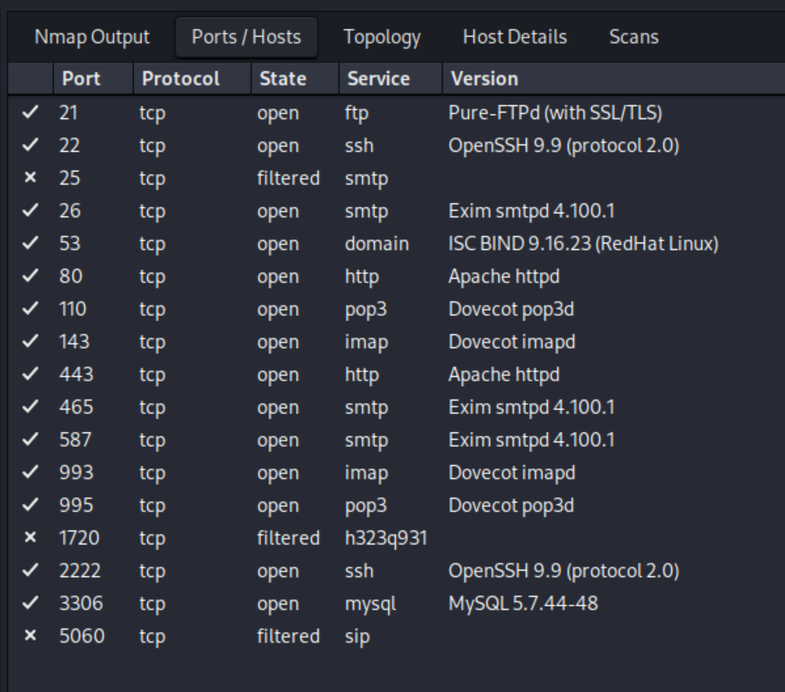
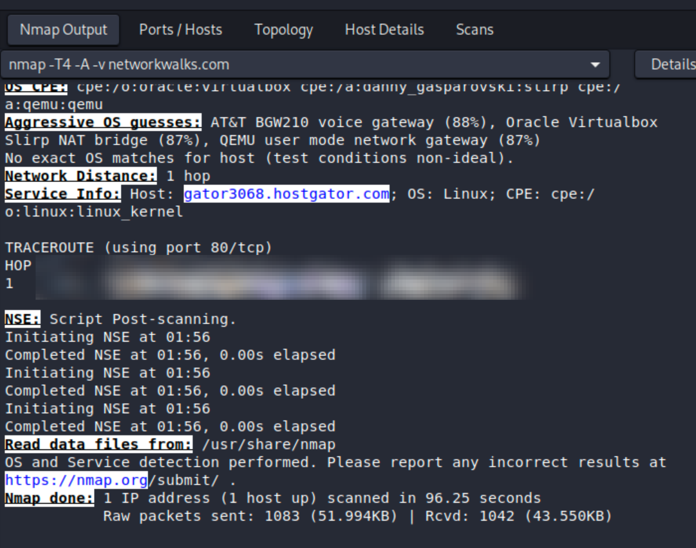
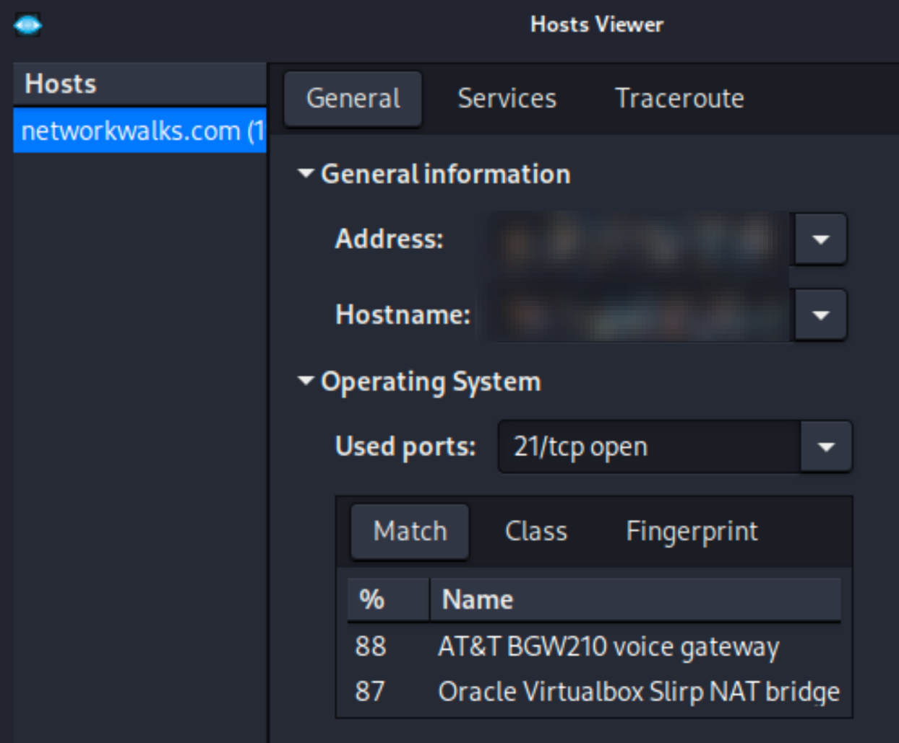

# 🛡️ NetworkWalks Cybersecurity Internship — Week 2 (W2-PM1): Footprinting & Reconnaissance Attacks


This repository documents the completion of the **Week 2 Project Module 1 (W2-PM1): Footprinting & Reconnaissance Attacks** as part of the Cybersecurity & Ethical Hacking Internship at [Networkwalks Academy](https://networkwalks.com/services/), patterned after the standard [NetworkWalks Week 2 Footprinting & Reconnaissance README Structure](https://github.com/oluwatobilobacybers/NETWORKWALKS-B083-WK2-CYBERSECURITY-FOOTPRINTING-SCANNING/blob/main/README.md).

## 📋 Project Overview & Objectives

The objective of this engagement was to conduct authorized reconnaissance and documented active service scanning against the internship-scoped target domain ([Networkwalks Academy](https://networkwalks.com/it-diploma-course/)) using standard [Kali Linux Reconnaissance Tools](https://www.kali.org/tools/) to map its external attack surface before active vulnerability assessment.

* **Gather domain registration and ownership intelligence** using [Kali WHOIS](https://www.kali.org/tools/whois/) to identify registrars, creation/expiration timelines, authoritative name servers, and DNSSEC status.
* **Fingerprint the web application technology stack** using [Kali WhatWeb](https://www.kali.org/tools/whatweb/) to uncover the underlying HTTP server, Content Management System (CMS), active plugins, and frontend JavaScript/CSS libraries.
* **Resolve domain-to-IP mappings** using [BIND 9 NSLookup (`bind9-dnsutils`)](https://www.kali.org/tools/bind9/) to determine the target's public IPv4 hosting address.
* **Inspect raw HTTP response headers** using [cURL (`libcurl`)](https://oxylabs.io/blog/curl-ignore-ssl) to evaluate caching layers, security policies, cookies, and exposed API endpoints.
* **Detect perimeter Web Application Firewalls (WAF)** using [Kali WAFW00F](https://www.kali.org/tools/wafw00f/) to determine whether incoming HTTP traffic is filtered by an inspection engine.
* **Enumerate DNS infrastructure and service records** using [Kali DNSRecon](https://www.kali.org/tools/dnsrecon/) to map `SOA`, `NS`, `A`, `MX`, and `SRV` autodiscovery records alongside DNS software versions.

## 🖥️ Lab Environment & Tools Used

| Component | Details | Reference / Documentation |
| :--- | :--- | :--- |
| **Operating System** | Kali Linux (`shahzeb@kali`) | [Kali Linux Tools Directory](https://www.kali.org/tools/) |
| **Reconnaissance Target** | `networkwalks.com` (`192.232.216.135`) | [Networkwalks Academy Contact & Scope](https://networkwalks.com/contact-us/) |
| **Task 1 Tool** | `whois` | [Kali Linux `whois` Package](https://www.kali.org/tools/whois/) |
| **Task 2 Tool** | `whatweb` | [Kali Linux `whatweb` Package](https://www.kali.org/tools/whatweb/) |
| **Task 3 Tool** | `nslookup` | [Kali Linux `bind9-dnsutils` Package](https://www.kali.org/tools/bind9/) |
| **Task 4 Tool** | `curl` | [cURL Command-Line Tool Guide](https://oxylabs.io/blog/curl-ignore-ssl) |
| **Task 5 Tool** | `wafw00f` (v2.4.2) | [Kali Linux `wafw00f` Package](https://www.kali.org/tools/wafw00f/) |
| **Task 6 Tool** | `dnsrecon` | [Kali Linux `dnsrecon` Package](https://www.kali.org/tools/dnsrecon/) |
| **Task 7 Tool** | Nmap / Zenmap | [Nmap documentation](https://nmap.org/docs.html) |

## Impact Rating Method

Impact labels are qualitative analyst assessments of the supplied evidence, not CVSS scores or confirmed exploitability. **Informational** describes expected service behavior, inventory, or observed controls; **Low** covers limited disclosure or hardening gaps; **Medium (provisional)** identifies exposure requiring configuration validation. High or Critical findings require stronger evidence than these screenshots provide. Conditional consequences are explained separately from observed facts. Version banners alone do not prove an affected CVE or missing vendor security backports.

## 📊 W2-PM1 Executive Findings Summary

| Task | Tool | Command Executed | Purpose | Key Reconnaissance Finding |
| :--- | :--- | :--- | :--- | :--- |
| **Task 1** | [WHOIS](https://www.kali.org/tools/whois/) | `whois networkwalks.com` | Domain registration lookup | **[Low]** Registered via GoDaddy (`IANA ID: 146`), hosted on HostGator name servers (`NS6135`/`NS6136`), `DNSSEC: unsigned`|
| **Task 2** | [WhatWeb](https://www.kali.org/tools/whatweb/) | `whatweb networkwalks.com` | Web technology fingerprinting | **[Low]** [Apache HTTP Server](https://wiki.hitme.pl/pomoc/linux/debian/instalacja-apache-mysql-i-php-lamp-debian/), WordPress `7.1.4`, [WordPress Download Manager (`3.3.76`)](https://wordpress.org/plugins/download-manager/), Bootstrap `7.1.4`, [jQuery (`3.7.1`)](https://tomitribe.com/cves/cve-2020-11023/), IP `192.232.216.135`, email `info@networkwalks.com`|
| **Task 3** | [NSLookup](https://www.kali.org/tools/bind9/) | `nslookup networkwalks.com` | DNS A-record resolution | **[Informational]** Resolves `networkwalks.com` to IPv4 address `192.232.216.135` via local VM NAT DNS server (`[REDACTED_LOCAL_DNS_IP]`)|
| **Task 4** | [cURL](https://oxylabs.io/blog/curl-ignore-ssl) | `curl -I https://networkwalks.com` | HTTP response header analysis | **[Low]** Returns `HTTP/2 200`, `server: Apache`, `x-nginx-cache: WordPress`, exposes `/wp-json/` REST API and `__wpdm_client` cookie|
| **Task 5** | [WAFW00F](https://www.kali.org/tools/wafw00f/) | `wafw00f networkwalks.com` | Web Application Firewall detection | **[Informational]** Protected by [ModSecurity (SpiderLabs) WAF](https://github.com/owasp-modsecurity/ModSecurity)|
| **Task 6** | [DNSRecon](https://www.kali.org/tools/dnsrecon/) | `dnsrecon -d networkwalks.com` | Comprehensive DNS enumeration | **[Low]** 8 records found (`SOA`, `NS`, `MX`, `A`, `SRV`); discloses `Bind Version 9.16.23-RH` and `cpanelemaildiscovery.cpanel.net` on port `443`|
| **Task 7** | Nmap / Zenmap | `nmap -T4 -A -v networkwalks.com` | Active service discovery and host review | **[Medium — provisional]** 14 open TCP ports, three filtered ports; database and mail/file-transfer controls require review; OS guesses inconclusive |

## 🔎 Detailed Reconnaissance Tasks & Technical Analysis

### Task 1 — Domain Registration Reconnaissance with WHOIS

#### Scan Command
```bash
whois networkwalks.com
```

#### Purpose
Query public domain registries using [Kali WHOIS](https://www.kali.org/tools/whois/) to extract registrar details, domain lifecycle timestamps, authoritative name servers, and EPP status locks.

#### Key Findings
* **[Informational] Domain Name & Registry ID**: `NETWORKWALKS.COM` (`2452319255_DOMAIN_COM-VRSN`)
* **[Informational] Registrar Details**: `GoDaddy.com, LLC` (IANA ID: `146`, WHOIS Server: `whois.godaddy.com`, Abuse Contact: `abuse@godaddy.com` / `480-624-2505`)
* **[Informational] Registration Timeline**: Created on `2019-11-06T22:51:46Z`, Updated on `2025-11-12T10:08:43Z`, Registry Expiry on `2027-11-06T22:51:46Z`
* **[Informational] Domain Status Locks**: `clientDeleteProhibited`, `clientRenewProhibited`, `clientTransferProhibited`, and `clientUpdateProhibited` are enabled.
* **[Informational] Authoritative Name Servers**: `NS6135.HOSTGATOR.COM` and `NS6136.HOSTGATOR.COM`
* **[Low] DNSSEC Configuration**: `unsigned`

#### Technical Analysis
The domain is actively locked against unauthorized registrar transfers or deletions via EPP status flags, which protects against direct registrar-level domain hijacking. However, the `NS6135.HOSTGATOR.COM` and `NS6136.HOSTGATOR.COM` records confirm shared/managed hosting infrastructure on HostGator, and `DNSSEC: unsigned` indicates that DNS responses are not cryptographically signed.

#### Evidence


### Task 2 — Web Technology Fingerprinting with WhatWeb

#### Scan Command
```bash
whatweb networkwalks.com
```

#### Purpose
Fingerprint the target website's HTTP behavior, server software, CMS version, plugins, and client-side libraries in a single pass using [Kali WhatWeb](https://www.kali.org/tools/whatweb/).

#### Key Findings
* **[Informational] HTTP to HTTPS Redirection**: `http://networkwalks.com` returns `301 Moved Permanently` and redirects to `https://networkwalks.com/` (`200 OK`).
* **[Informational] Hosting & Network Identity**: Resolves to IPv4 `192.232.216.135` (`Country[UNITED STATES][US]`) with page title `Networkwalks Academy`.
* **[Low] Web Server & Caching Headers**: Runs [Apache HTTP Server](https://wiki.hitme.pl/pomoc/linux/debian/instalacja-apache-mysql-i-php-lamp-debian/) and exposes uncommon headers including `x-endurance-cache-level`, `x-nginx-cache`, `x-redirect-by`, `permissions-policy`, and `referrer-policy`.
* **[Low] CMS & Active Plugin Versions**: `MetaGenerator` explicitly discloses `WordPress 7.1.4` and [WordPress Download Manager (`3.3.76`)](https://wordpress.org/plugins/download-manager/) alongside cookie `__wpdm_client` (`HttpOnly`).
* **[Informational] Frontend Libraries & Analytics**: Uses `Bootstrap[7.1.4]`, [jQuery (`3.7.1`)](https://tomitribe.com/cves/cve-2020-11023/), `HTML5`, `Open-Graph-Protocol[website]`, and `Google-Tag-Manager`.
* **[Informational] Public Contact Discovery**: Extracts the organization's contact email address `info@networkwalks.com` directly from page metadata.

#### Technical Analysis
[WhatWeb](https://www.kali.org/tools/whatweb/) confirms that while HTTP traffic is properly redirected to HTTPS (`301 Moved Permanently`), the site leaves verbose version banners enabled in its HTML `MetaGenerator` tags (`WordPress 7.1.4` and `WordPress Download Manager 3.3.76`). Exposing exact plugin version numbers significantly narrows the research effort required to check for known plugin vulnerabilities.

#### Evidence


### Task 3 — DNS Resolution with NSLookup

#### Scan Command
```bash
nslookup networkwalks.com
```

#### Purpose
Query the Domain Name System using [BIND 9 NSLookup (`bind9-dnsutils`)](https://www.kali.org/tools/bind9/) to verify the IPv4 `A` record associated with [Networkwalks Academy](https://networkwalks.com/it-diploma-course/).

#### Key Findings
* **[Informational] Querying Resolver**: Local virtual network DNS forwarder (`[REDACTED_LOCAL_DNS_IP]#53` — *recommended to redact as `[REDACTED_LOCAL_DNS_IP]` before publishing*)
* **[Informational] Target Domain Name**: `networkwalks.com`
* **[Informational] Resolved IPv4 Address (Non-Authoritative Answer)**: `192.232.216.135`

#### Technical Analysis
The query returns a non-authoritative answer from the local recursive resolver confirming that `networkwalks.com` maps directly to `192.232.216.135` from the local recursive resolver. This establishes the observed DNS mapping; it does not prove the address is an unproxied origin server.

#### Evidence


### Task 4 — HTTP Response Header Inspection with cURL

#### Scan Command
```bash
curl -I https://networkwalks.com
```

#### Purpose
Send an HTTP `HEAD` request (`-I`) using [cURL](https://oxylabs.io/blog/curl-ignore-ssl) to inspect the raw response headers returned by the web server without downloading the full HTML body.

#### Key Findings
* **[Informational] Status & Protocol**: `HTTP/2 200` on `Tue, 10 Nov 2026 05:51:30 GMT`
* **[Low] Web Server & Reverse Proxy Cache**: `server: Apache`, `x-endurance-cache-level: 0`, and `x-nginx-cache: WordPress`
* **[Informational] Exposed WordPress REST API & Page ID**: The `link` header reveals `<https://networkwalks.com/wp-json/>; rel="https://api.w.org/"` and `<https://networkwalks.com/wp-json/wp/v2/pages/53>; rel="alternate"; title="JSON"; type="application/json"`.
* **[Low] Session Cookie Attributes**: `set-cookie: __wpdm_client=[REDACTED_COOKIE_VALUE]; path=/; domain=networkwalks.com; secure; HttpOnly` (generated by [WordPress Download Manager](https://www.wpdownloadmanager.com/))
* **[Low] Security & Privacy Policies**: `referrer-policy: no-referrer-when-downgrade` and a `permissions-policy` allowing `private-state-token-redemption` and `private-state-token-issuance` for `google.com`, `gstatic.com`, `recaptcha.net`, `challenges.cloudflare.com`, and `hcaptcha.com`.

#### Technical Analysis
The headers suggest a possible NGINX reverse-proxy cache (`x-nginx-cache: WordPress`) sitting in front of an [Apache HTTP Server](https://wiki.hitme.pl/pomoc/linux/debian/instalacja-apache-mysql-i-php-lamp-debian/) on an Endurance International Group (HostGator) stack (`x-endurance-cache-level: 0`). The `set-cookie` header properly enforces `secure` and `HttpOnly` flags on `__wpdm_client`, though it omits `SameSite`. Notably, key hardening headers such as `Strict-Transport-Security` (HSTS), `Content-Security-Policy` (CSP), `X-Frame-Options`, and `X-Content-Type-Options` are absent from the response.

#### Evidence


### Task 5 — Web Application Firewall (WAF) Detection with WAFW00F

#### Scan Command
```bash
wafw00f networkwalks.com
```

#### Purpose
Probe `https://networkwalks.com` using [Kali WAFW00F](https://www.kali.org/tools/wafw00f/) (`v2.4.2`) to determine whether HTTP traffic is inspected by a Web Application Firewall.

#### Key Findings
* **[Informational] Target Checked**: `https://networkwalks.com`
* **[Informational] Detected WAF**: [ModSecurity (SpiderLabs) WAF](https://github.com/owasp-modsecurity/ModSecurity)
* **[Informational] Probe Efficiency**: Identified in `2` requests.

#### Technical Analysis
The application is protected by [ModSecurity](https://modsecurity.org/), an open-source WAF commonly deployed with the [OWASP ModSecurity Core Rule Set (CRS)](https://github.com/Spiderlabs/owasp-modsecurity-crs) on Apache/cPanel environments to block generic SQL Injection (SQLi), Cross-Site Scripting (XSS), and Local File Inclusion (LFI) payloads. Knowing that ModSecurity is active warns penetration testers that noisy automated scanners will trigger `403 Forbidden` blocks or IP rate-limiting unless requests are throttled or obfuscated.

#### Evidence


### Task 6 — Comprehensive DNS Enumeration with DNSRecon

#### Scan Command
```bash
dnsrecon -d networkwalks.com
```

#### Purpose
Perform general DNS enumeration and service (`SRV`) record discovery against `networkwalks.com` using [Kali DNSRecon](https://www.kali.org/tools/dnsrecon/).

#### Key Findings
* **[Low] DNSSEC Verification**: `ERROR No answer for DNSSEC query for networkwalks.com` (corroborating the `DNSSEC: unsigned` result from Task 1).
* **[Informational] Start of Authority (`SOA`)**: `ns6135.hostgator.com` (`50.87.144.87`)
* **[Low] Authoritative Name Servers (`NS`) & Software Version Disclosure**:
  * `ns6135.hostgator.com` (`50.87.144.87`) — discloses `Bind Version "9.16.23-RH"`
  * `ns6136.hostgator.com` (`192.232.216.131`) — discloses `Bind Version "9.16.23-RH"`
* **[Informational] Mail Exchange (`MX`) & Host (`A`) Records**:
  * `MX`: `mail.networkwalks.com` → `192.232.216.135`
  * `A`: `networkwalks.com` → `192.232.216.135`
* **[Informational] Service (`SRV`) Autodiscovery Records (8 Total Records Found)**:
  * `_autodiscover._tcp.networkwalks.com` points to `cpanelemaildiscovery.cpanel.net` on TCP port `443` across eight IPv4 endpoints (`184.94.203.9`, `184.94.203.11`, `184.94.203.14`, `184.94.203.15`, `184.94.204.9`, `184.94.204.11`, `184.94.204.14`, `184.94.204.15`).

#### Technical Analysis
[DNSRecon](https://www.kali.org/tools/dnsrecon/) provides three architectural indicators:
1. Both authoritative name servers respond to `version.bind` CHAOS queries with `9.16.23-RH`, indicating a Red Hat Enterprise Linux (RHEL) build of [ISC BIND 9](https://www.kali.org/tools/bind9/).
2. The `MX` record (`mail.networkwalks.com`) resolves to the exact same IPv4 address (`192.232.216.135`) as the main web server, indicating shared addressing; physical hosting and isolation cannot be confirmed from DNS alone.
3. The `_autodiscover._tcp` `SRV` records pointing to `cpanelemaildiscovery.cpanel.net` are consistent with cPanel mail autodiscovery; they do not establish reachable cPanel/WHM administrative services.

#### Evidence


### Task 7 — Active Service Discovery and Host Review with Nmap / Zenmap

#### Recorded Command and Scope

```bash
nmap -T4 -A -v networkwalks.com
```

The command visible in the supplied output uses `-T4` for faster timing, `-A` for OS detection, service/version detection, default scripts and traceroute, and `-v` for verbose output. It is active scanning. No `-p-` option is shown, so this is not evidence of an all-port assessment. The cropped output and port view are the available evidence; the complete Nmap XML and script results were not supplied.

#### Findings and Observed Services

The screenshot contains **14 open TCP ports** and **3 filtered TCP ports**. Ratings below prioritize configuration review; they do not establish that any service is exploitable. Port states describe the scanner's view at scan time.

| Impact level | Port / TCP | Observed state | Reported service / banner | Interpretation and recommended action |
| :--- | :--- | :--- | :--- | :--- |
| **Medium (provisional)** | 21 | Open | FTP — Pure-FTPd (with SSL/TLS) | File-transfer endpoint reachable. TLS support does not prove TLS is mandatory. Require encrypted authentication and transfers; disable anonymous access unless intended. |
| **Low** | 22 | Open | SSH — OpenSSH 9.9, protocol 2.0 | Remote administration exposed from the scan vantage. Review key-only authentication, permitted users, patch status and source restrictions. No authentication weakness demonstrated. |
| **Informational** | 25 | Filtered | SMTP label; no banner shown | Nmap could not establish whether a listener is open. Filtering is not proof the service is absent or universally inaccessible. |
| **Medium (provisional)** | 26 | Open | SMTP — Exim smtpd 4.100.1 | Alternate mail endpoint. Validate its purpose, relay restrictions, authentication and TLS enforcement. Open relay is not demonstrated. |
| **Low** | 53 | Open | DNS — ISC BIND 9.16.23 (Red Hat Linux) | TCP DNS reachable and version reported. Authoritative TCP DNS can be expected; validate recursion and zone-transfer policy with the owner. Neither unrestricted recursion nor zone transfer is shown. |
| **Informational** | 80 | Open | HTTP — Apache httpd | Expected web service; earlier WhatWeb evidence shows an HTTPS redirect. Review consistent redirect behavior and HSTS coverage. |
| **Medium (provisional)** | 110 | Open | POP3 — Dovecot pop3d | Mail retrieval endpoint. Require STARTTLS before authentication, or disable this listener if unnecessary. Cleartext credential acceptance was not tested. |
| **Medium (provisional)** | 143 | Open | IMAP — Dovecot imapd | Review mandatory STARTTLS and authentication policy. An open listener alone does not establish unencrypted login. |
| **Informational** | 443 | Open | HTTP service label — Apache httpd | Conventional HTTPS port; the earlier cURL evidence shows an HTTPS response. This row alone does not validate certificates, cipher suites or TLS versions. |
| **Informational** | 465 | Open | SMTP — Exim smtpd 4.100.1 | Conventional implicit-TLS mail endpoint. Validate TLS, certificates, authentication and anti-relay policy; these settings are not visible here. |
| **Informational** | 587 | Open | SMTP — Exim smtpd 4.100.1 | Conventional mail submission endpoint. Require authentication and TLS; the screenshot does not establish their enforcement. |
| **Informational** | 993 | Open | IMAP — Dovecot imapd | Conventional implicit-TLS IMAP endpoint. Review TLS and certificate configuration; no TLS assessment supplied. |
| **Informational** | 995 | Open | POP3 — Dovecot pop3d | Conventional implicit-TLS POP3 endpoint. Review TLS and certificate configuration; no TLS assessment supplied. |
| **Informational** | 1720 | Filtered | h323q931 label; no banner shown | Inconclusive service state. The label is not confirmed application identification. |
| **Low** | 2222 | Open | SSH — OpenSSH 9.9, protocol 2.0 | Second SSH listener. Confirm business need and apply the same controls as port 22. A different port does not supply access control. |
| **Medium (provisional)** | 3306 | Open | MySQL 5.7.44-48 | Database listener reachable from the scanning environment. Confirm intended clients, source restrictions, account privileges, TLS and vendor maintenance status. No database access or data disclosure demonstrated. |
| **Informational** | 5060 | Filtered | SIP label; no banner shown | Filtering prevented a conclusive open/closed determination. No SIP service or weakness confirmed. |

#### Evidence 7A — Ports / Hosts View



**Description:** The Ports / Hosts tab lists TCP port states and reported service fingerprints. It supports the inventory above, including the database listener and two SSH listeners. It does not show credentials, successful logins, exploited CVEs or complete TLS settings.

#### Evidence 7B — Nmap Output View



**Description:** The output shows the recorded command, one host up, completion in **96.25 seconds**, **1,083 raw packets sent**, and **1,042 received**. Service information reports `gator3068.hostgator.com`, Linux and `cpe:/o:linux:linux_kernel`.

**[Informational] OS identification is inconclusive:** The same output explicitly states no exact OS match and non-ideal test conditions. It lists AT&T BGW210 (88%), Oracle VirtualBox Slirp NAT (87%) and QEMU user-mode gateway (87%) as guesses. These are competing fingerprint matches, not verified device identities. The Linux service hint is separate from TCP/IP OS matching. NAT or middlebox effects are a possible explanation, not a confirmed cause.

#### Evidence 7C — Host Viewer



**Description:** The Host Viewer shows `21/tcp open` as a port used for OS fingerprinting and repeats the uncertain OS matches. The address and hostname fields are redacted. This view is not an independent confirmation of the guessed operating system.

#### Evidence 7D — Topology View


**Description:** The topology displays localhost and a connected node. The output reports a network distance of one hop using TCP port 80 for traceroute. With intermediate details redacted and possible virtualization effects, the diagram cannot establish the target's physical location, LAN membership or full network path. Node color is a visualization property, not a validated vulnerability severity rating.

#### Potential Impact and Remediation Priority

* **[Medium — provisional] Reachable database:** Unauthorized access, if a separate authentication or software weakness existed, could expose or alter application data. The scan only establishes listener reachability. Prioritize source allowlists, least privilege, TLS and vendor patch review.
* **[Medium — provisional] File-transfer and mail encryption policy:** If login or transfer were permitted without encryption, an on-path observer could capture credentials or content. Require TLS and validate policy before treating this consequence as confirmed.
* **[Low] Remote administration and version disclosure:** SSH endpoints and banners assist service mapping. Review business necessity and access restrictions; no successful attack is evidenced.
* **[Informational] OS and route uncertainty:** Retain confidence percentages and the non-ideal-conditions warning. Use owner-provided asset records and full authorized scan output to resolve uncertainty.

#### References

* [Nmap port states and default TCP port coverage](https://nmap.org/book/man-port-scanning-basics.html)
* [Nmap OS detection and imperfect matches](https://nmap.org/book/man-os-detection.html)
* [Nmap aggressive scan options](https://nmap.org/book/man-misc-options.html)

## Findings, Impact Levels and Defensive Recommendations

These ratings describe evidence-backed observations and provisional review priorities. No High or Critical vulnerability has been established. Public DNS records, normal REST API discovery and an enabled WAF are not themselves exploitable findings.

| Impact level | Finding | Evidence and potential consequence | Recommended action |
| :--- | :--- | :--- | :--- |
| **Low** | CMS / plugin and DNS software banners | Tasks 2 and 6 report versions that assist reconnaissance. Fingerprints may be inaccurate; vendor backports and applicability must be checked before assigning a CVE. | Verify the installed packages, maintain supported releases and reduce unnecessary banners. |
| **Low** | DNSSEC reported unsigned | WHOIS reports unsigned; DNSRecon returned no DNSSEC answer. The latter alone would not prove unsigned status. Missing signing removes DNSSEC authenticity protection; it does not prove poisoning is feasible. | Review DNSSEC deployment with the DNS provider and registrar. |
| **Low** | HTTP hardening headers absent in the captured response | The shown HEAD response lacks HSTS, CSP, X-Frame-Options and X-Content-Type-Options. This is response-specific evidence; clickjacking or transport downgrade was not demonstrated. | Assess required policies across relevant pages and responses, then deploy and test appropriate headers. |
| **Low** | Cookie lacks explicit SameSite in captured response | Secure and HttpOnly are present. Missing SameSite is a hardening observation; browser defaults and application behavior affect risk. No CSRF demonstrated. | Set an explicit SameSite policy compatible with application flows and keep anti-CSRF controls. |
| **Informational** | WordPress REST API discovery | Public API and page links are shown. User enumeration, unauthorized data access and authentication bypass were not tested. | Review endpoint permissions and minimize unintended public fields. |
| **Informational** | Hosting / public contact / shared addressing | Domain records and banners support hosting attribution. Shared web/mail addressing does not prove isolation failure or exposed management ports. | Maintain asset inventory, access controls, mail authentication and phishing awareness. |
| **Informational — observed control** | ModSecurity WAF detected | WAFW00F reports ModSecurity. This does not prove coverage, specific rules, or a bypass. | Maintain and monitor the WAF alongside application security controls. |
| **Medium (provisional)** | MySQL listener reachable | Task 7 shows 3306/tcp open and a MySQL banner. Unauthorized database access is not shown. | Restrict approved sources and review privileges, TLS and vendor support. |
| **Medium (provisional)** | FTP and mail policy requires validation | Task 7 shows 21, 26, 110 and 143/tcp open. Encryption support or conventional ports do not prove encryption enforcement. | Require TLS, validate authentication / relay policy and disable unnecessary listeners. |
| **Low** | SSH on two ports | Task 7 shows 22 and 2222/tcp open. Weak credentials or insecure configuration were not demonstrated. | Review need, permitted sources, key-based authentication and patching. |
| **Informational** | Uncertain OS guesses / filtered ports / topology | Screenshots show imperfect matches, three filtered ports and a limited route view. None establishes a vulnerable OS, active filtered service or severity score. | Preserve uncertainty and correlate with owner inventory and full scan output. |

## 🧠 Key Learning Outcomes

* **Systematic Reconnaissance Workflow**: Executed a structured footprinting workflow followed by a documented active service scan progressing from passive registry lookups ([WHOIS](https://www.kali.org/tools/whois/)) to DNS mapping ([NSLookup](https://www.kali.org/tools/bind9/), [DNSRecon](https://www.kali.org/tools/dnsrecon/)) and application-layer profiling ([WhatWeb](https://www.kali.org/tools/whatweb/), [cURL](https://oxylabs.io/blog/curl-ignore-ssl), [WAFW00F](https://www.kali.org/tools/wafw00f/)).
* **Attack Surface Correlation**: Connected disparate technical artifacts—such as `x-endurance-cache-level` headers, `NS6135.HOSTGATOR.COM` name servers, and `cpanelemaildiscovery.cpanel.net` `SRV` records—to build an accurate profile of the target's shared cPanel/HostGator hosting architecture.
* **Defensive & Adversarial Thinking**: Evaluated how seemingly minor metadata leaks (such as `Bind Version 9.16.23-RH`, `WordPress Download Manager 3.3.76`, and `/wp-json/` links) assist attackers and formulated concrete hardening controls.
* **Responsible Documentation & OPSEC**: Applied data hygiene by redacting session cookies (`__wpdm_client`) and internal network resolver addresses before public reporting.

## 🔐 Security & Ethical Considerations

All reconnaissance activities documented in this repository were conducted strictly within the authorized scope of the [Networkwalks Academy](https://networkwalks.com/services/) Cybersecurity & Ethical Hacking Internship program against the designated training domain (`networkwalks.com`). The evidence includes passive lookups, web fingerprinting, DNS enumeration, and an active Nmap scan with default scripts. No vulnerability exploitation, brute-forcing, or service disruption is demonstrated in the supplied evidence. This update documents existing screenshots; it does not represent a new scan.

## 👤 Author & Project Metadata

* **Author**: Shahzeb Ali — Batch B084
* **Internship Program**: Cybersecurity & Ethical Hacking Internship — [Networkwalks Academy](https://networkwalks.com/it-diploma-course/)
* **Module**: Week 2 — Project Module 1 (`W2-PM1`: Footprinting & Reconnaissance Attacks)
* **GitHub Profile**: [ishahzebali](https://github.com/ishahzebali)

