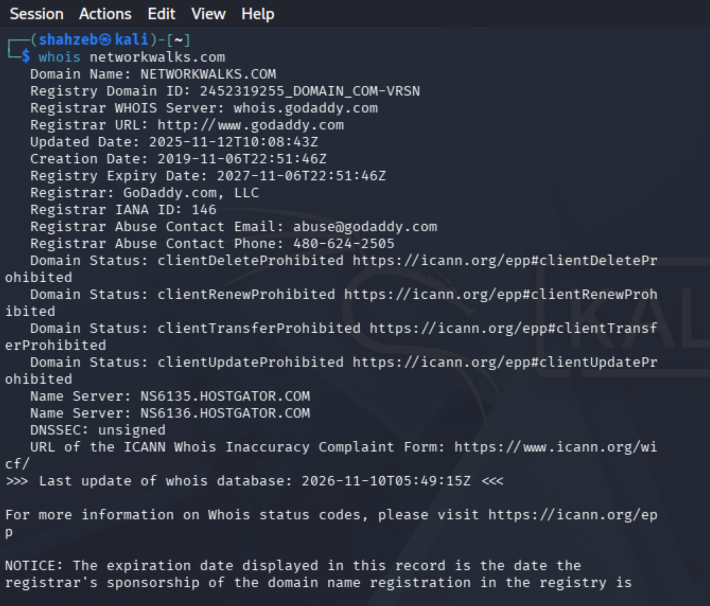
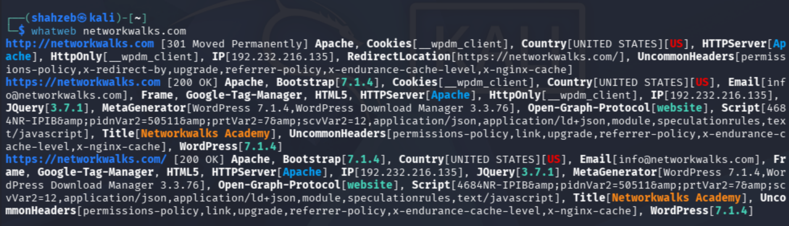
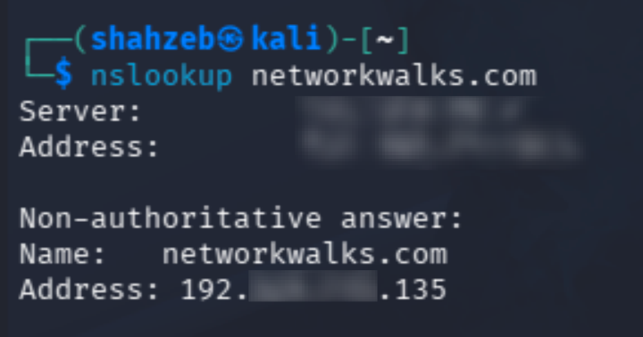
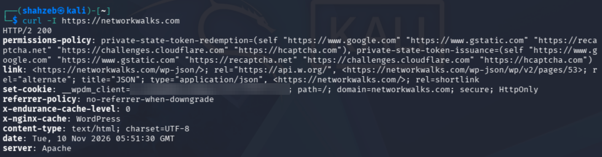
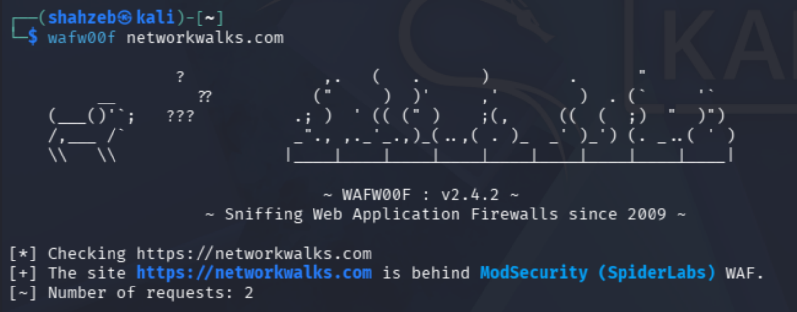
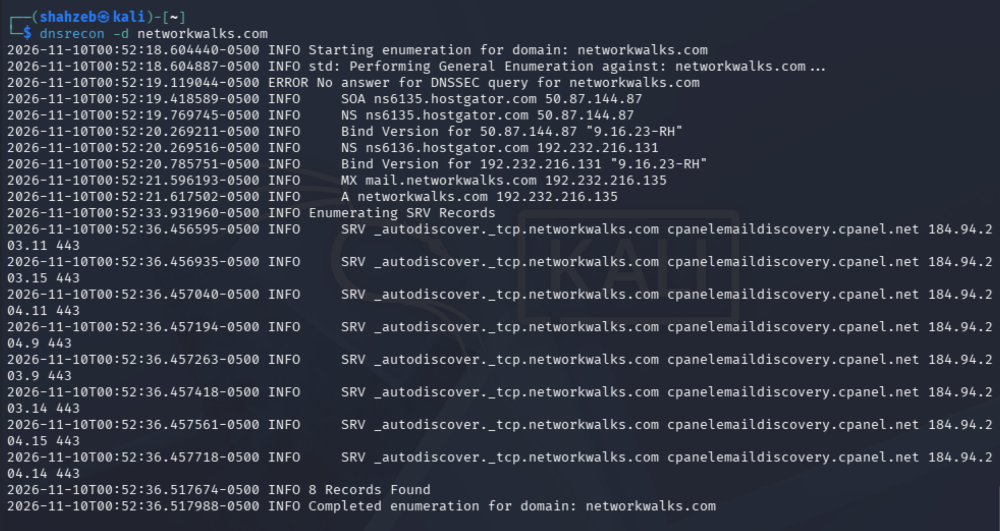

# 🛡️ NetworkWalks Cybersecurity Internship — Week 2 (W2-PM1): Footprinting & Reconnaissance Attacks


This repository documents the completion of the **Week 2 Project Module 1 (W2-PM1): Footprinting & Reconnaissance Attacks** as part of the Cybersecurity & Ethical Hacking Internship at [Networkwalks Academy](https://networkwalks.com/services/), patterned after the standard [NetworkWalks Week 2 Footprinting & Reconnaissance README Structure](https://github.com/oluwatobilobacybers/NETWORKWALKS-B083-WK2-CYBERSECURITY-FOOTPRINTING-SCANNING/blob/main/README.md).

## 📋 Project Overview & Objectives

The objective of this engagement was to conduct authorized passive and semi-passive reconnaissance against the internship-scoped target domain ([Networkwalks Academy](https://networkwalks.com/it-diploma-course/)) using standard [Kali Linux Reconnaissance Tools](https://www.kali.org/tools/) to map its external attack surface before active vulnerability assessment.

* **Gather domain registration and ownership intelligence** using [Kali WHOIS](https://www.kali.org/tools/whois/) to identify registrars, creation/expiration timelines, authoritative name servers, and DNSSEC status.
* **Fingerprint the web application technology stack** using [Kali WhatWeb](https://www.kali.org/tools/whatweb/) to uncover the underlying HTTP server, Content Management System (CMS), active plugins, and frontend JavaScript/CSS libraries.
* **Resolve domain-to-IP mappings** using [BIND 9 NSLookup (`bind9-dnsutils`)](https://www.kali.org/tools/bind9/) to determine the target's public IPv4 hosting address.
* **Inspect raw HTTP response headers** using [cURL (`libcurl`)](https://oxylabs.io/blog/curl-ignore-ssl) to evaluate caching layers, security policies, cookies, and exposed API endpoints.
* **Detect perimeter Web Application Firewalls (WAF)** using [Kali WAFW00F](https://www.kali.org/tools/wafw00f/) to determine whether incoming HTTP traffic is filtered by an inspection engine.
* **Enumerate DNS infrastructure and service records** using [Kali DNSRecon](https://www.kali.org/tools/dnsrecon/) to map `SOA`, `NS`, `A`, `MX`, and `SRV` autodiscovery records alongside DNS software versions.

## 🖥️ Lab Environment & Tools Used

| Component | Details | Reference / Documentation |
| :--- | :--- | :--- |
| **Operating System** | Kali Linux (`shahzeb@kali`) | [Kali Linux Tools Directory](https://www.kali.org/tools/) |
| **Reconnaissance Target** | `networkwalks.com` (`192.232.216.135`) | [Networkwalks Academy Contact & Scope](https://networkwalks.com/contact-us/) |
| **Task 1 Tool** | `whois` | [Kali Linux `whois` Package](https://www.kali.org/tools/whois/) |
| **Task 2 Tool** | `whatweb` | [Kali Linux `whatweb` Package](https://www.kali.org/tools/whatweb/) |
| **Task 3 Tool** | `nslookup` | [Kali Linux `bind9-dnsutils` Package](https://www.kali.org/tools/bind9/) |
| **Task 4 Tool** | `curl` | [cURL Command-Line Tool Guide](https://oxylabs.io/blog/curl-ignore-ssl) |
| **Task 5 Tool** | `wafw00f` (v2.4.2) | [Kali Linux `wafw00f` Package](https://www.kali.org/tools/wafw00f/) |
| **Task 6 Tool** | `dnsrecon` | [Kali Linux `dnsrecon` Package](https://www.kali.org/tools/dnsrecon/) |

## 📊 W2-PM1 Executive Findings Summary

| Task | Tool | Command Executed | Purpose | Key Reconnaissance Finding |
| :--- | :--- | :--- | :--- | :--- |
| **Task 1** | [WHOIS](https://www.kali.org/tools/whois/) | `whois networkwalks.com` | Domain registration lookup | Registered via GoDaddy (`IANA ID: 146`), hosted on HostGator name servers (`NS6135`/`NS6136`), `DNSSEC: unsigned` |
| **Task 2** | [WhatWeb](https://www.kali.org/tools/whatweb/) | `whatweb networkwalks.com` | Web technology fingerprinting | [Apache HTTP Server](https://wiki.hitme.pl/pomoc/linux/debian/instalacja-apache-mysql-i-php-lamp-debian/), WordPress `7.1.4`, [WordPress Download Manager (`3.3.76`)](https://wordpress.org/plugins/download-manager/), Bootstrap `7.1.4`, [jQuery (`3.7.1`)](https://tomitribe.com/cves/cve-2020-11023/), IP `192.232.216.135`, email `info@networkwalks.com` |
| **Task 3** | [NSLookup](https://www.kali.org/tools/bind9/) | `nslookup networkwalks.com` | DNS A-record resolution | Resolves `networkwalks.com` to IPv4 address `192.232.216.135` via local VM NAT DNS server (`[REDACTED_LOCAL_DNS_IP]`) |
| **Task 4** | [cURL](https://oxylabs.io/blog/curl-ignore-ssl) | `curl -I https://networkwalks.com` | HTTP response header analysis | Returns `HTTP/2 200`, `server: Apache`, `x-nginx-cache: WordPress`, exposes `/wp-json/` REST API and `__wpdm_client` cookie |
| **Task 5** | [WAFW00F](https://www.kali.org/tools/wafw00f/) | `wafw00f networkwalks.com` | Web Application Firewall detection | Protected by [ModSecurity (SpiderLabs) WAF](https://github.com/owasp-modsecurity/ModSecurity) |
| **Task 6** | [DNSRecon](https://www.kali.org/tools/dnsrecon/) | `dnsrecon -d networkwalks.com` | Comprehensive DNS enumeration | 8 records found (`SOA`, `NS`, `MX`, `A`, `SRV`); discloses `Bind Version 9.16.23-RH` and `cpanelemaildiscovery.cpanel.net` on port `443` |

## 🔎 Detailed Reconnaissance Tasks & Technical Analysis

### Task 1 — Domain Registration Reconnaissance with WHOIS

#### Scan Command
```bash
whois networkwalks.com
```

#### Purpose
Query public domain registries using [Kali WHOIS](https://www.kali.org/tools/whois/) to extract registrar details, domain lifecycle timestamps, authoritative name servers, and EPP status locks.

#### Key Findings
* **Domain Name & Registry ID**: `NETWORKWALKS.COM` (`2452319255_DOMAIN_COM-VRSN`)
* **Registrar Details**: `GoDaddy.com, LLC` (IANA ID: `146`, WHOIS Server: `whois.godaddy.com`, Abuse Contact: `abuse@godaddy.com` / `480-624-2505`)
* **Registration Timeline**: Created on `2019-11-06T22:51:46Z`, Updated on `2025-11-12T10:08:43Z`, Registry Expiry on `2027-11-06T22:51:46Z`
* **Domain Status Locks**: `clientDeleteProhibited`, `clientRenewProhibited`, `clientTransferProhibited`, and `clientUpdateProhibited` are enabled.
* **Authoritative Name Servers**: `NS6135.HOSTGATOR.COM` and `NS6136.HOSTGATOR.COM`
* **DNSSEC Configuration**: `unsigned`

#### Technical Analysis
The domain is actively locked against unauthorized registrar transfers or deletions via EPP status flags, which protects against direct registrar-level domain hijacking. However, the `NS6135.HOSTGATOR.COM` and `NS6136.HOSTGATOR.COM` records confirm shared/managed hosting infrastructure on HostGator, and `DNSSEC: unsigned` indicates that DNS responses are not cryptographically signed.

#### Evidence




### Task 2 — Web Technology Fingerprinting with WhatWeb

#### Scan Command
```bash
whatweb networkwalks.com
```

#### Purpose
Fingerprint the target website's HTTP behavior, server software, CMS version, plugins, and client-side libraries in a single pass using [Kali WhatWeb](https://www.kali.org/tools/whatweb/).

#### Key Findings
* **HTTP to HTTPS Redirection**: `http://networkwalks.com` returns `301 Moved Permanently` and redirects to `https://networkwalks.com/` (`200 OK`).
* **Hosting & Network Identity**: Resolves to IPv4 `192.232.216.135` (`Country[UNITED STATES][US]`) with page title `Networkwalks Academy`.
* **Web Server & Caching Headers**: Runs [Apache HTTP Server](https://wiki.hitme.pl/pomoc/linux/debian/instalacja-apache-mysql-i-php-lamp-debian/) and exposes uncommon headers including `x-endurance-cache-level`, `x-nginx-cache`, `x-redirect-by`, `permissions-policy`, and `referrer-policy`.
* **CMS & Active Plugin Versions**: `MetaGenerator` explicitly discloses `WordPress 7.1.4` and [WordPress Download Manager (`3.3.76`)](https://wordpress.org/plugins/download-manager/) alongside cookie `__wpdm_client` (`HttpOnly`).
* **Frontend Libraries & Analytics**: Uses `Bootstrap[7.1.4]`, [jQuery (`3.7.1`)](https://tomitribe.com/cves/cve-2020-11023/), `HTML5`, `Open-Graph-Protocol[website]`, and `Google-Tag-Manager`.
* **Public Contact Discovery**: Extracts the organization's contact email address `info@networkwalks.com` directly from page metadata.

#### Technical Analysis
[WhatWeb](https://www.kali.org/tools/whatweb/) confirms that while HTTP traffic is properly redirected to HTTPS (`301 Moved Permanently`), the site leaves verbose version banners enabled in its HTML `MetaGenerator` tags (`WordPress 7.1.4` and `WordPress Download Manager 3.3.76`). Exposing exact plugin version numbers significantly narrows the research effort required to check for known plugin vulnerabilities.

#### Evidence




### Task 3 — DNS Resolution with NSLookup

#### Scan Command
```bash
nslookup networkwalks.com
```

#### Purpose
Query the Domain Name System using [BIND 9 NSLookup (`bind9-dnsutils`)](https://www.kali.org/tools/bind9/) to verify the IPv4 `A` record associated with [Networkwalks Academy](https://networkwalks.com/it-diploma-course/).

#### Key Findings
* **Querying Resolver**: Local virtual network DNS forwarder (`[REDACTED_LOCAL_DNS_IP]#53` — *recommended to redact as `[REDACTED_LOCAL_DNS_IP]` before publishing*)
* **Target Domain Name**: `networkwalks.com`
* **Resolved IPv4 Address (Non-Authoritative Answer)**: `192.232.216.135`

#### Technical Analysis
The query returns a non-authoritative answer from the local recursive resolver confirming that `networkwalks.com` maps directly to `192.232.216.135` rather than an anycast CDN proxy IP, exposing the origin hosting server IP for subsequent port and service scanning.

#### Evidence




### Task 4 — HTTP Response Header Inspection with cURL

#### Scan Command
```bash
curl -I https://networkwalks.com
```

#### Purpose
Send an HTTP `HEAD` request (`-I`) using [cURL](https://oxylabs.io/blog/curl-ignore-ssl) to inspect the raw response headers returned by the web server without downloading the full HTML body.

#### Key Findings
* **Status & Protocol**: `HTTP/2 200` on `Tue, 10 Nov 2026 05:51:30 GMT`
* **Web Server & Reverse Proxy Cache**: `server: Apache`, `x-endurance-cache-level: 0`, and `x-nginx-cache: WordPress`
* **Exposed WordPress REST API & Page ID**: The `link` header reveals `<https://networkwalks.com/wp-json/>; rel="https://api.w.org/"` and `<https://networkwalks.com/wp-json/wp/v2/pages/53>; rel="alternate"; title="JSON"; type="application/json"`.
* **Session Cookie Attributes**: `set-cookie: __wpdm_client=[REDACTED_COOKIE_VALUE]; path=/; domain=networkwalks.com; secure; HttpOnly` (generated by [WordPress Download Manager](https://www.wpdownloadmanager.com/))
* **Security & Privacy Policies**: `referrer-policy: no-referrer-when-downgrade` and a `permissions-policy` allowing `private-state-token-redemption` and `private-state-token-issuance` for `google.com`, `gstatic.com`, `recaptcha.net`, `challenges.cloudflare.com`, and `hcaptcha.com`.

#### Technical Analysis
Inspecting the headers confirms an NGINX reverse-proxy cache (`x-nginx-cache: WordPress`) sitting in front of an [Apache HTTP Server](https://wiki.hitme.pl/pomoc/linux/debian/instalacja-apache-mysql-i-php-lamp-debian/) on an Endurance International Group (HostGator) stack (`x-endurance-cache-level: 0`). The `set-cookie` header properly enforces `secure` and `HttpOnly` flags on `__wpdm_client`, though it omits `SameSite`. Notably, key hardening headers such as `Strict-Transport-Security` (HSTS), `Content-Security-Policy` (CSP), `X-Frame-Options`, and `X-Content-Type-Options` are absent from the response.

#### Evidence




### Task 5 — Web Application Firewall (WAF) Detection with WAFW00F

#### Scan Command
```bash
wafw00f networkwalks.com
```

#### Purpose
Probe `https://networkwalks.com` using [Kali WAFW00F](https://www.kali.org/tools/wafw00f/) (`v2.4.2`) to determine whether HTTP traffic is inspected by a Web Application Firewall.

#### Key Findings
* **Target Checked**: `https://networkwalks.com`
* **Detected WAF**: [ModSecurity (SpiderLabs) WAF](https://github.com/owasp-modsecurity/ModSecurity)
* **Probe Efficiency**: Identified in `2` requests.

#### Technical Analysis
The application is protected by [ModSecurity](https://modsecurity.org/), an open-source WAF commonly deployed with the [OWASP ModSecurity Core Rule Set (CRS)](https://github.com/Spiderlabs/owasp-modsecurity-crs) on Apache/cPanel environments to block generic SQL Injection (SQLi), Cross-Site Scripting (XSS), and Local File Inclusion (LFI) payloads. Knowing that ModSecurity is active warns penetration testers that noisy automated scanners will trigger `403 Forbidden` blocks or IP rate-limiting unless requests are throttled or obfuscated.

#### Evidence




### Task 6 — Comprehensive DNS Enumeration with DNSRecon

#### Scan Command
```bash
dnsrecon -d networkwalks.com
```

#### Purpose
Perform general DNS enumeration and service (`SRV`) record discovery against `networkwalks.com` using [Kali DNSRecon](https://www.kali.org/tools/dnsrecon/).

#### Key Findings
* **DNSSEC Verification**: `ERROR No answer for DNSSEC query for networkwalks.com` (corroborating the `DNSSEC: unsigned` result from Task 1).
* **Start of Authority (`SOA`)**: `ns6135.hostgator.com` (`50.87.144.87`)
* **Authoritative Name Servers (`NS`) & Software Version Disclosure**:
  * `ns6135.hostgator.com` (`50.87.144.87`) — discloses `Bind Version "9.16.23-RH"`
  * `ns6136.hostgator.com` (`192.232.216.131`) — discloses `Bind Version "9.16.23-RH"`
* **Mail Exchange (`MX`) & Host (`A`) Records**:
  * `MX`: `mail.networkwalks.com` → `192.232.216.135`
  * `A`: `networkwalks.com` → `192.232.216.135`
* **Service (`SRV`) Autodiscovery Records (8 Total Records Found)**:
  * `_autodiscover._tcp.networkwalks.com` points to `cpanelemaildiscovery.cpanel.net` on TCP port `443` across eight IPv4 endpoints (`184.94.203.9`, `184.94.203.11`, `184.94.203.14`, `184.94.203.15`, `184.94.204.9`, `184.94.204.11`, `184.94.204.14`, `184.94.204.15`).

#### Technical Analysis
[DNSRecon](https://www.kali.org/tools/dnsrecon/) reveals three critical architectural details:
1. Both authoritative name servers respond to `version.bind` CHAOS queries with `9.16.23-RH`, indicating a Red Hat Enterprise Linux (RHEL) build of [ISC BIND 9](https://www.kali.org/tools/bind9/).
2. The `MX` record (`mail.networkwalks.com`) resolves to the exact same IPv4 address (`192.232.216.135`) as the main web server, meaning web and mail services share the same host.
3. The `_autodiscover._tcp` `SRV` records pointing to `cpanelemaildiscovery.cpanel.net` confirm a cPanel/WHM control panel environment.

#### Evidence




## ⚠️ What an Attacker Can Do With These Findings (Adversarial Impact & Defensive Mitigations)

Even though passive and semi-passive footprinting does not directly exploit the target, an adversary can chain the intelligence gathered from Tasks 1–6 into targeted exploitation scenarios:

| Reconnaissance Finding | Source Task(s) | What an Attacker Can Do (Adversarial Exploitation Path) | Recommended Defensive Mitigation |
| :--- | :--- | :--- | :--- |
| **Exposed CMS & Plugin Versions (`WordPress 7.1.4`, `WordPress Download Manager 3.3.76`)** | Task 2 ([WhatWeb](https://www.kali.org/tools/whatweb/)) | Query vulnerability databases for CVEs affecting [WordPress Download Manager](https://wordpress.org/plugins/download-manager/) (such as unauthenticated file upload, arbitrary file download, or privilege escalation flaws) and craft targeted exploits without blind guessing. | Remove WordPress `generator` meta tags, keep all plugins updated, and restrict direct PHP execution in upload directories. |
| **Exposed WordPress REST API (`/wp-json/` & `/wp/v2/pages/53`)** | Task 4 ([cURL](https://oxylabs.io/blog/curl-ignore-ssl)) | Query `/wp-json/wp/v2/users` to enumerate valid administrator/author usernames, map internal page/post IDs, and launch targeted password brute-force or credential-stuffing attacks against `/wp-login.php` or `xmlrpc.php`. | Disable unauthenticated REST API user endpoints (`/wp/v2/users`), enforce Multi-Factor Authentication (MFA), and rate-limit login attempts. |
| **Disclosed DNS Software Version (`Bind Version 9.16.23-RH`)** | Task 6 ([DNSRecon](https://www.kali.org/tools/dnsrecon/)) | Research specific CVEs tied to Red Hat's `BIND 9.16.23-RH` package (such as DNS assertion failures or resource exhaustion DoS vulnerabilities) to disrupt name resolution for `networkwalks.com`. | Hide the BIND version banner by setting `version "Not Disclosed";` inside the `options` block of `named.conf` on authoritative name servers. |
| **Unsigned DNS Zone (`DNSSEC: unsigned`)** | Task 1 ([WHOIS](https://www.kali.org/tools/whois/)) & Task 6 ([DNSRecon](https://www.kali.org/tools/dnsrecon/)) | Perform DNS cache poisoning or Man-in-the-Middle (MitM) DNS spoofing on unencrypted networks to redirect users to a fraudulent clone of `networkwalks.com` because resolvers cannot cryptographically validate DNS records. | Enable DNSSEC signing at the DNS hosting provider (HostGator) and publish the `DS` record with the registrar (GoDaddy). |
| **Co-Located Web & Mail Server (`192.232.216.135`) + cPanel Autodiscovery** | Task 2, Task 3, & Task 6 ([DNSRecon](https://www.kali.org/tools/dnsrecon/)) | Target exposed cPanel/WHM management ports (`2083`, `2087`, `2096`) and mail services (`SMTP/25`, `IMAP/143`, `POP3/110`, `SMTPS/465`, `Submission/587`) on `192.232.216.135`, or abuse mail services to degrade web server performance. | Restrict cPanel administrative ports to trusted management IPs, enforce strong mail authentication (`SPF`, `DKIM`, `DMARC`), and segregate mail from web hosting where feasible. |
| **Identified WAF (`ModSecurity SpiderLabs`)** | Task 5 ([WAFW00F](https://www.kali.org/tools/wafw00f/)) | Test known [ModSecurity](https://github.com/owasp-modsecurity/ModSecurity) rule-set bypasses (such as payload encoding, HTTP parameter pollution, or chunked transfer encoding) in a local lab before sending payloads to the live site. | Keep the [OWASP ModSecurity Core Rule Set (CRS)](https://github.com/Spiderlabs/owasp-modsecurity-crs) updated, tune anomaly thresholds, and combine WAF filtering with secure application coding (parameterized queries). |
| **Missing HTTP Security Headers (`HSTS`, `CSP`, `X-Frame-Options`)** | Task 4 ([cURL](https://oxylabs.io/blog/curl-ignore-ssl)) | Frame the site inside a malicious page for Clickjacking attacks (due to missing `X-Frame-Options` / `frame-ancestors`) or perform SSL-stripping on first-time HTTP connections (`http://networkwalks.com` before the `301` redirect) due to missing HSTS. | Configure Apache/NGINX to return `Strict-Transport-Security`, `Content-Security-Policy`, `X-Frame-Options: SAMEORIGIN`, and `X-Content-Type-Options: nosniff`, and add `SameSite=Lax` to cookies. |
| **Exposed Organizational Email (`info@networkwalks.com`) & Registrar Info** | Task 1 ([WHOIS](https://www.kali.org/tools/whois/)) & Task 2 ([WhatWeb](https://www.kali.org/tools/whatweb/)) | Craft convincing spear-phishing pretexts impersonating GoDaddy (`abuse@godaddy.com`), HostGator, or cPanel support regarding domain expiration (`2027-11-06`) or SSL renewals targeting `info@networkwalks.com`. | Train staff on registrar/hosting phishing lures, enforce hardware security keys (FIDO2/WebAuthn) on registrar and hosting accounts, and monitor incoming mail with anti-spoofing controls. |

## 🧠 Key Learning Outcomes

* **Systematic Reconnaissance Workflow**: Executed a structured 6-stage footprinting methodology progressing from passive registry lookups ([WHOIS](https://www.kali.org/tools/whois/)) to DNS mapping ([NSLookup](https://www.kali.org/tools/bind9/), [DNSRecon](https://www.kali.org/tools/dnsrecon/)) and application-layer profiling ([WhatWeb](https://www.kali.org/tools/whatweb/), [cURL](https://oxylabs.io/blog/curl-ignore-ssl), [WAFW00F](https://www.kali.org/tools/wafw00f/)).
* **Attack Surface Correlation**: Connected disparate technical artifacts—such as `x-endurance-cache-level` headers, `NS6135.HOSTGATOR.COM` name servers, and `cpanelemaildiscovery.cpanel.net` `SRV` records—to build an accurate profile of the target's shared cPanel/HostGator hosting architecture.
* **Defensive & Adversarial Thinking**: Evaluated how seemingly minor metadata leaks (such as `Bind Version 9.16.23-RH`, `WordPress Download Manager 3.3.76`, and `/wp-json/` links) assist attackers and formulated concrete hardening controls.
* **Responsible Documentation & OPSEC**: Applied data hygiene by redacting session cookies (`__wpdm_client`) and internal network resolver addresses before public reporting.

## 🔐 Security & Ethical Considerations

All reconnaissance activities documented in this repository were conducted strictly within the authorized scope of the [Networkwalks Academy](https://networkwalks.com/services/) Cybersecurity & Ethical Hacking Internship program against the designated training domain (`networkwalks.com`). Only passive and non-intrusive enumeration techniques were performed; no vulnerability exploitation, brute-forcing, or service disruption took place.

## 👤 Author & Project Metadata

* **Author**: Shahzeb Ali — Batch B084
* **Internship Program**: Cybersecurity & Ethical Hacking Internship — [Networkwalks Academy](https://networkwalks.com/it-diploma-course/)
* **Module**: Week 2 — Project Module 1 (`W2-PM1`: Footprinting & Reconnaissance Attacks)
* **GitHub Profile**: [ishahzebali](https://github.com/ishahzebali)

